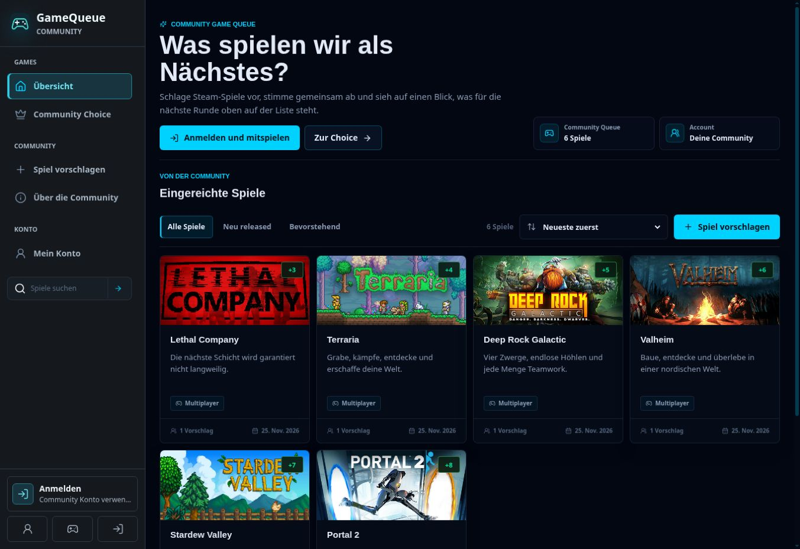
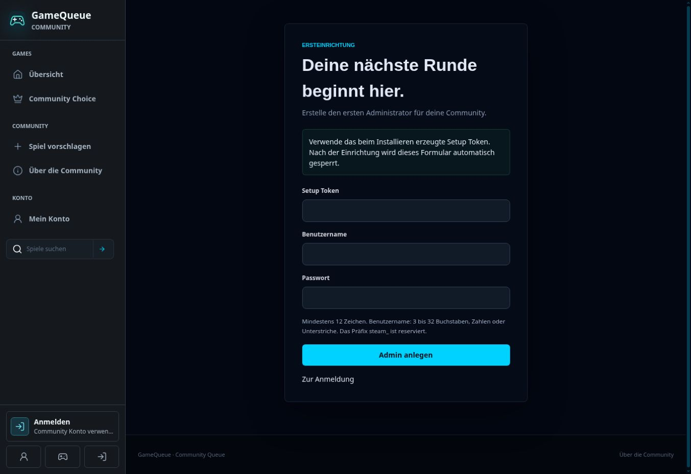
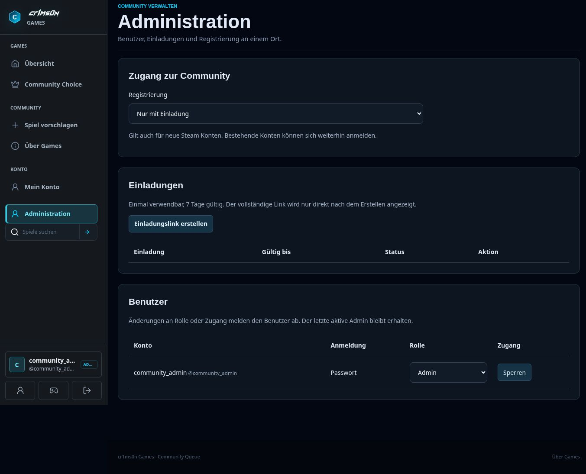

<p align="center">
  
</p>
<h1 align="center">GameQueue</h1>
<p align="center"><strong>Your community. Your next game.</strong></p>
<p align="center">A self-hosted game queue for discovering, suggesting and choosing what to play together.</p>
<p align="center">
  
  
  
  <a href="LICENSE"></a>
</p>



**Standalone by design.** Games runs on its own database and accounts. No Hub, ACP, shared cookies or central authentication service is required. The interface is currently in German.

[Features](#features) · [Quick start](#quick-start) · [Accounts and access](#accounts-and-access) · [Configuration](#configuration) · [Development](#development)

## Features

| Discover and decide | Run your community |
| --- | --- |
| Import games from Steam links or app IDs | One-time administrator setup |
| Covers, descriptions, screenshots and release information | Local username/password accounts |
| Community voting and comments | Optional Steam OpenID sign-in |
| Search, filters, sorting and pagination | Open, invite-only or closed registration |
| Planned, playing, played and rejected statuses | Expiring, single-use invitation links |
| Admin scores and a Community Choice view | User roles, account blocking and session revocation |
| Responsive navigation and dark interface | Docker Compose and GitHub Actions CI |
| Neutral GameQueue defaults | Admin-editable site name and site icon |

## Quick start

Requirements: Docker with Compose and Node.js 24 or newer for the configuration helper. The container stack runs the app and PostgreSQL together.

```sh
git clone https://github.com/cr1ms0nx64/gamequeue.git
cd gamequeue
npm run setup:env
```

The helper creates `.env.local` with random database credentials and a setup token. It refuses to overwrite an existing configuration.

1. Set `PUBLIC_ORIGIN` in `.env.local` to the exact origin visitors will use. Keep `http://localhost:3000` for local evaluation; use an HTTPS origin for a public installation.
2. Start the stack:

   ```sh
   docker compose --env-file .env.local up -d --build
   ```

3. Open your configured origin and complete `/setup`. Enter `SETUP_TOKEN` from `.env.local`, choose an administrator username and create a password of at least 12 characters.
4. Open **Administration** to create invitations or change the registration policy.
5. Remove `SETUP_TOKEN` from `.env.local` after setup, then recreate the app container:

   ```sh
   docker compose --env-file .env.local up -d --force-recreate app
   ```

The app binds to `127.0.0.1:3000`; PostgreSQL is available only inside the Compose network. Put a reverse proxy in front for public access. Data persists in the `postgres_data` volume. Use a fresh database for this standalone edition.

<details>
<summary><strong>Administrator setup</strong></summary>



The setup endpoint is locked after the first account has been created. Concurrent setup requests cannot create additional administrators.

</details>

## Accounts and access

The first administrator is created locally through `/setup`. Subsequent accounts are ordinary users unless an administrator promotes them.

| Registration mode | New local accounts | New Steam accounts | Existing accounts |
| --- | --- | --- | --- |
| Invite only, default | Valid invitation required | Valid invitation required | Can sign in |
| Open | Can register | Created on first verified sign-in | Can sign in |
| Closed | Cannot register | Cannot register | Can sign in |

In **Administration**, create a link and share it with the intended member. Each invitation is valid for seven days, can be redeemed once and can be revoked. The full invitation link is shown only when it is created. Invalid or expired invitations are rejected, including during Steam registration.



### Site name and icon

Open **Administration → Name und Seitenicon** to customize the name and icon for your installation. Upload a PNG, JPEG or WebP up to 512 KB. Images are validated and converted to a 512 × 512 PNG, with transparent padding to preserve their proportions. The result is stored in PostgreSQL and used in navigation, browser tabs and bookmarks. Changes survive restarts and container replacements without a separate upload volume.

Use **Standardicon verwenden** and save to restore the neutral default icon. The site name updates the header, footer and page titles. Only administrators can save these settings. Existing installations gain the required settings columns automatically.

### Steam sign-in

Set `STEAM_AUTH_ENABLED=true` to show the Steam option. Authentication happens on Steam's own website through OpenID; this app never receives Steam passwords. Basic sign-in does not require a Steam Web API key.

Configure a reachable HTTPS `PUBLIC_ORIGIN` before using Steam in production. The callback is `/api/auth/steam/callback`. Steam accounts receive an automatically generated username and can change their display name under **Mein Konto**. They are not automatically linked to local accounts with matching names.

Steam-only accounts continue authenticating through Steam. Local accounts can change their password from **Mein Konto**, which ends all existing sessions. Email password recovery and local MFA are not included in this release.

## Configuration

| Variable | Purpose |
| --- | --- |
| `DATABASE_URL` | Dedicated PostgreSQL connection string; Compose supplies the internal database address |
| `DB_PASSWORD` | PostgreSQL password used by Compose; generated by the setup helper |
| `PUBLIC_ORIGIN` | Exact external origin, including scheme and port where applicable, without a path |
| `SETUP_TOKEN` | Required for first administrator creation; remove after setup |
| `STEAM_AUTH_ENABLED` | `true` enables Steam OpenID sign-in |
| `TRUST_PROXY` | Standard `false`; hinter einem abgesicherten Reverse Proxy zwingend `true` |
| `TRUSTED_PROXY_HOPS` | Standard `1`; vertrauenswürdige Client-Adresse von rechts in X-Forwarded-For |
| `STEAM_REFRESH_DELAY_MS` | Standard `1500`, mindestens `1000`; Abstand im manuellen Steam-Aktualisierungsskript |
| `IMPRINT_URL` | Optional URL for your installation's legal notice |
| `PRIVACY_URL` | Optional URL for your installation's privacy policy |

Keep `.env.local` private. Do not reuse Hub secrets. With `TRUST_PROXY=false`, unauthenticated rate limits share one client bucket; configure a trusted proxy before enabling forwarded IP handling.

### Example reverse proxy

Replace the domain and TLS paths with your own. The proxy must overwrite `X-Forwarded-For`, and clients must not be able to bypass it.

```nginx
server {
    listen 443 ssl;
    server_name games.example.com;
    ssl_certificate /path/to/fullchain.pem;
    ssl_certificate_key /path/to/privkey.pem;

    location / {
        proxy_pass http://127.0.0.1:3000;
        proxy_set_header Host $host;
        proxy_set_header X-Forwarded-Proto $scheme;
        proxy_set_header X-Forwarded-For $remote_addr;
    }
}
```

Set `PUBLIC_ORIGIN=https://games.example.com`. Add your normal HTTP to HTTPS redirect. After changing runtime variables, recreate the app container.

### Native Node.js deployment

Provide PostgreSQL 17 or newer, configure `.env.local` for that database, then:

```sh
npm ci
npm run build
npm start
```

The build prepares Next.js standalone output, including public files and static assets. Set `HOSTNAME=127.0.0.1` and `PORT=3000` in your service environment when binding behind a local proxy. Der Start wendet versionierte Migrationen vor dem Serverstart an; Anfragen führen kein DDL aus.

`GET /api/health` returns HTTP 200 when the games database is available and HTTP 503 when it is unavailable.

## Development

```sh
npm ci
npm run setup:env
# Configure DATABASE_URL for your local PostgreSQL instance.
npm run dev
```

```sh
npm run lint
npm test
npm run typecheck
npm run build
npm run test:upgrade
```

The integration suite requires a running app and a fresh disposable database. See [CONTRIBUTING.md](CONTRIBUTING.md). GitHub Actions provisions PostgreSQL 17 and runs the security tests, type checking, build and integration suite.

### Validierung für 1.3.0

Die CI prüft Linting ohne Warnungen, Runtime-Audit, Unit-Tests, TypeScript, Standalone-Build, node:test-Integration, Upgrade von 1.2.0 und einen separaten Docker-Build ohne Push. Die bisherigen 77 Integrationsprüfungen bleiben erhalten; mit den neuen Fällen sind es 239. Die Integration ist ein sequenzieller `node:test`-Ablauf, damit Setup und Folgeaktionen dieselbe Wegwerf-Installation verwenden.

Ein echter Steam-Login, der Betrieb hinter dem eigenen Reverse Proxy, die Wiederherstellung eines echten Backups und ein Compose-Start auf dem Zielsystem bleiben manuelle Prüfungen. Alle Details stehen im [Umsetzungsbericht](docs/IMPLEMENTATION-1.3.md).

## Historische Hub-Daten

Es werden keine Hub-Identitäten geraten oder automatisch mit lokalen Konten verknüpft. Das Upgrade von 1.2.0 ordnet nur `local:N` einem vorhandenen lokalen Konto zu. Andere Einträge bleiben vollständig im geschützten Archiv `legacy_orphans` erhalten. Für die Übernahme einer alten Hub-Installation ist eine ausdrücklich geprüfte Zuordnung erforderlich. Siehe [Architektur](docs/ARCHITECTURE.md) und [Sicherheit](SECURITY.md).

## Project

* [Changelog](CHANGELOG.md)
* [Architecture and provenance](docs/ARCHITECTURE.md)
* [Security model](SECURITY.md)
* [Contributing](CONTRIBUTING.md)

Source code is available under the [MIT License](LICENSE). Steam and game artwork belong to their respective owners; the code license does not grant rights to third-party artwork.

Steam authentication references: [Steamworks authentication documentation](https://partner.steamgames.com/doc/features/auth) and [OpenID Authentication 2.0](https://openid.net/specs/openid-authentication-2_0.html).

## Reverse Proxy und Login-Limits

Hinter einem Reverse Proxy **muss `TRUST_PROXY=true` gesetzt werden**. Der Proxy muss `X-Forwarded-For` überschreiben oder seine tatsächlich beobachtete Client-IP rechts anhängen. Direkter Zugriff auf die App muss gesperrt sein. `TRUSTED_PROXY_HOPS=1` liest den rechten Eintrag; nur bei einer kontrollierten mehrstufigen Proxy-Kette erhöhen. Ungültige Adressen ergeben `unknown`. Ohne vertrauenswürdigen Proxy ist keine Client-IP aus Fetch-Requests verfügbar; dann wird ein gemeinsamer Zähler verwendet. Erkannte Fehlkonfigurationen erzeugen eine Prozesswarnung und einen Admin-Hinweis.

Login zählt nur fehlgeschlagene Passwortprüfungen: 10 Fehler pro Benutzername und IP, 50 pro Benutzername und 60 pro IP innerhalb von 15 Minuten. Eine erfolgreiche Anmeldung setzt diese Fehlerzähler zurück. Registrierung, Setup und Steam-Start zählen weiterhin jeden Versuch.

## Passwort vergessen

Ein Admin kann unter Administration für lokale Konten einen einmaligen Link erstellen. Er gilt 24 Stunden, ersetzt ältere Links und beendet bei Verwendung alle Sitzungen. Der Link wird nur beim Erstellen angezeigt und muss vertraulich weitergegeben werden. Steam-Konten verwenden die Wiederherstellung bei Steam.

Notfallweg für den einzigen lokalen Admin (direkter Datenbankzugriff erforderlich):

```sh
npm run reset-admin -- benutzername
docker compose exec app node scripts/reset-admin.mjs benutzername
```

`DATABASE_URL` und `PUBLIC_ORIGIN` müssen gesetzt sein. Der ausgegebene Link ist ein Geheimnis und gehört nicht in öffentliche Logs.

## Steam-Metadaten aktualisieren

Admins können Daten auf der Spielseite erneut von Steam laden. Status, Bewertungen und Vorschläge bleiben dabei erhalten. Für Cron steht `npm run refresh-steam` zur Verfügung. Alle Spiele werden nacheinander aktualisiert; zwischen Anfragen liegen standardmäßig 1500 ms (`STEAM_REFRESH_DELAY_MS`, mindestens 1000). Der Webserver startet keinen Hintergrundprozess. Für dieses Skript gilt ebenfalls Node.js 24 und eine gesetzte `DATABASE_URL`.

## Upgrade von 1.2.0 und Migrationen

Vor dem Upgrade die App stoppen und die Datenbank sichern. Die alte App darf während der Schemaumstellung nicht weiterlaufen. Beispiel für das Compose-Setup:

```sh
docker compose stop app
docker compose exec -T db pg_dump -U games -d games -Fc > gamequeue-before-1.3.dump
# Anschließend den neuen Quellstand auschecken.
docker compose build app
docker compose up -d app
docker compose logs app
```

Der Start führt Migrationen vor `server.js` aus. Jede SQL-Datei hat eine gespeicherte SHA-256-Prüfsumme, läuft unter einer Datenbanksperre und in einer eigenen Transaktion. Geänderte bereits angewendete Migrationen brechen den Start ab. SQL-Dateien nach der Anwendung nicht bearbeiten. Bei manueller Installation: `npm ci`, `npm run migrate`, `npm run build`, `npm start`. `npm run dev` migriert ebenfalls vor dem Start.

| Migration | Wirkung |
| --- | --- |
| 0001 | Baseline des Schemas 1.2.0, auch auf bestehenden Tabellen anwendbar |
| 0002 | `local:N` wird mit vorhandenen Konten verknüpft; Fremdschlüssel ersetzen Text-IDs und Namenskopien |
| 0003 | Passwort-Reset, `coming_soon` und eindeutige Anzeigenamen |

Nicht zuordenbare Votes, Kommentare und Vorschläge werden vollständig als JSON in `legacy_orphans` archiviert. Spiele bleiben erhalten, unbekannte Ersteller werden `NULL`. Doppelte Alt-Referenzen werden ebenfalls archiviert; die kanonische Referenz bleibt aktiv. Bei kollidierenden oder ungültigen Anzeigenamen wird das alte Profil archiviert und ein eindeutiger Ersatzname vergeben. Benutzernamen, Passwörter und Anmeldungen bleiben erhalten. Das Migrationslog nennt die Anzahl archivierter Einträge.

```sql
SELECT source_table, reason, COUNT(*) FROM legacy_orphans GROUP BY source_table, reason;
SELECT id, source_table, legacy_key, data FROM legacy_orphans ORDER BY id;
```

Die archivierten Daten enthalten personenbezogene Informationen und gegebenenfalls Passwort-Hashes alter Profile. Nicht öffentlich weitergeben. Eine Zuordnung ehemaliger Hub-IDs wird bewusst nicht geraten. Der Upgrade-Test (`npm run test:upgrade`) erstellt ausschließlich bei `TEST_DATABASE_DISPOSABLE=1` eine eigene temporäre Datenbank und prüft Erhalt, Archivierung, erneuten Start und Prüfsummenfehler.

## Backup und Wiederherstellung

Regelmäßig Datenbank und `.env.local` getrennt und geschützt sichern. Ein vollständiges Backup enthält Benutzerprofile, Passwort-Hashes, Tokens als Hashes und gegebenenfalls historische Archive. Für einen konsistenten Wiederherstellungspunkt die App anhalten:

```sh
docker compose stop app
docker compose exec -T db pg_dump -U games -d games -Fc > gamequeue.dump
docker compose up -d app
```

Zur Wiederherstellung eine eigene Datenbank bzw. ein leeres PostgreSQL-Volume verwenden. Der folgende Restore ersetzt vorhandene Daten in der Zieldatenbank:

```sh
docker compose stop app
docker compose exec -T db pg_restore -U games -d games --clean --if-exists --no-owner --exit-on-error < gamequeue.dump
docker compose up -d app
docker compose ps
```

Die App prüft beim Start die Migrationen und meldet Datenbank-/Migrationsprobleme über `/api/health`. Docker und Compose verwenden diesen Endpunkt. Healthcheck-Fehler im App-Log prüfen, bevor weitere Updates erfolgen.

## Mein Konto und Datenschutz

Unter „Mein Konto“ lassen sich Profil und eigene Community-Daten als JSON exportieren. Eine Kontolöschung benötigt den exakten Benutzernamen und bei lokalen Konten das aktuelle Passwort. Sitzungen, Votes, Kommentare, Vorschläge und zuordenbare archivierte Einträge werden gelöscht; Spiele bleiben mit unbekanntem Ersteller bestehen. Der letzte aktive Administrator kann nicht gelöscht werden.

HTML erhält eine neue CSP-Nonce pro Anfrage; produktives `script-src` enthält kein `unsafe-inline`. Styles behalten zur Wahrung des bestehenden Designs ihre Inline-Freigabe. HTML darf am Reverse Proxy nicht zwischengespeichert werden. Bei HTTPS-PUBLIC_ORIGIN wird HSTS gesetzt.
