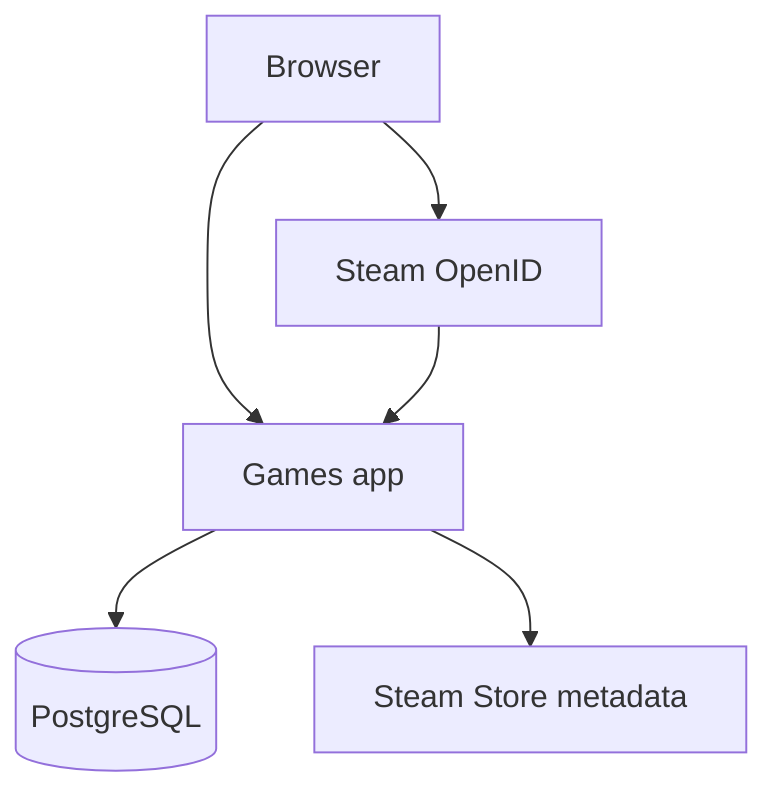

# Architecture

Next.js serves the UI and route handlers. PostgreSQL stores game suggestions, submissions, votes, comments, local accounts, hashed sessions, admission settings, invite hashes, rate limits and transient Steam state/nonces. No Hub, ACP, Redis or shared cookie service is required.

Local setup, admission, invite use and administrator changes share a transaction-level advisory lock. Steam account creation uses the same admission transaction as password registration. Database uniqueness protects usernames and Steam identities. Each request resolves role and disabled status from the database. Participation IDs use a local: prefix to isolate standalone users from historical numeric Hub identities.

## Provenance

Extracted from cr1ms0nx64/cr1ms0n-suite, commit f60cd227bffe583e1b87c1c97dc5598cd0623ab6, directory games-app. Original MIT attribution is retained. The standalone release intentionally starts with a separate account namespace and contains no production database or credentials.

